#  VE Mobile

[](https://github.com/Silvestrae/ve-mobile/releases/latest)


[](LICENSE)
[](https://github.com/Silvestrae/ve-mobile/releases)
[](https://ko-fi.com/silvestrae)

**Your Foundry game, designed for touch.**

VE Mobile gives Foundry Virtual Tabletop a dedicated phone and tablet interface
for **Dungeons & Dragons Fifth Edition** and **Pathfinder Second Edition**.
Read your character, roll saves, cast spells, manage equipment, follow chat,
and move tokens through layouts built for a smaller screen.

Open your usual Foundry world in a browser and sign in—no separate app or account
is required. Rolls and actions use your game system and its usual chat cards,
permissions, and automation.

<p align="center">
  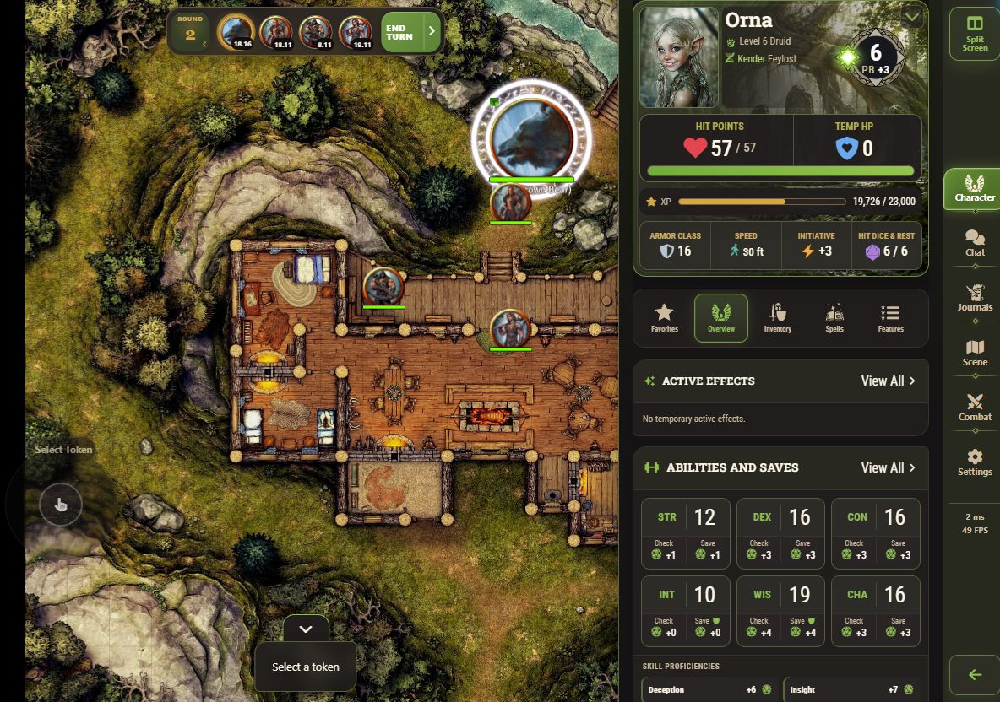
</p>

*The introduction image shows D&D5e. [PF2e phone screenshots](#pf2e-phone-screenshots)
appear in the PF2e section below.*

## Contents

- [Compatibility](#compatibility)
- [Install and start playing](#install-and-start-playing)
- [Phone and tablet layouts](#phone-and-tablet-layouts)
- [Dungeons & Dragons Fifth Edition](#dungeons--dragons-fifth-edition)
- [Pathfinder Second Edition](#pathfinder-second-edition)
- [Controls and shortcuts](#controls-and-shortcuts)
- [Scene and token movement](#scene-and-token-movement)
- [Chat, journals, and combat](#chat-journals-and-combat)
- [Appearance and performance](#appearance-and-performance)
- [Troubleshooting](#troubleshooting)
- [Feedback and support](#feedback-and-support)
- [License and credits](#license-and-credits)

## Compatibility

| Game system | Minimum requirements |
| --- | --- |
| **D&D5e** | Foundry 13; D&D5e 5.3.2 |
| **PF2e** | Foundry 14; PF2e 8.6.1 |

**PF2e requires Foundry v14+.** Other game systems are not currently supported.

<details>
<summary>Tested versions and compatibility notes</summary>

- D&D5e: Foundry 13.351 / D&D5e 5.3.3 and Foundry 14.369 / D&D5e 6.0.6.
- PF2e: Foundry 14.369 / PF2e 8.6.1.

These tests do not cover every version, device, or combination of modules.
Live maps need working Canvas graphics. Your Foundry permissions determine
which actors and controls you can use.

</details>

The repository README may include unreleased changes. Check the
[release notes](https://github.com/Silvestrae/ve-mobile/releases) for the features
included in a particular download.

## Install and start playing

1. In Foundry **Setup**, open **Add-on Modules → Install Module**.
2. Paste this address into **Manifest URL**, then select **Install**:

   ```text
   https://github.com/Silvestrae/ve-mobile/releases/latest/download/module.json
   ```

3. Launch a supported world and enable **VE Mobile** in **Manage Modules**.
4. Fully reload Foundry, then open the world in your phone or tablet browser
   and sign in with your usual world account.

<details>
<summary>Manual installation</summary>

Extract the module ZIP from the
[latest release](https://github.com/Silvestrae/ve-mobile/releases/latest) into
`Data/modules/ve-mobile`. Place `module.json` directly in that folder, alongside
`src`, `assets`, and `locales`, then fully reload Foundry.

</details>

On first use:

- Choose **Auto-detect**, **Phone**, or **Tablet** in **Mobile Mode** if needed.
- Use the **character header chevron** to open the actor chooser.
- Tap item rows to read details; use their action controls to roll or cast.
- Choose **Joystick** or **D-pad** in **Settings → Scene & Controls → Movement control**.
- Open **Settings → Support → Controls & Gestures** for the touch guide.

## Phone and tablet layouts

| Layout | How it works |
| --- | --- |
| **Phone** | One content pane with bottom navigation. Character headers compact as you scroll. |
| **Tablet Split** | The live Scene beside a sheet, chat, or other content in landscape. Headers compact within the sheet pane. |
| **Tablet Full** | A wide content surface with side navigation. Character headers stay expanded. |

Auto-detect selects a presentation for your device. You can choose a mode
explicitly; Tablet's Split Screen control switches between Split and Full.
Character tabs scroll horizontally and retain their content position and
expanded sections for the current actor view during the session.

<p align="center">
  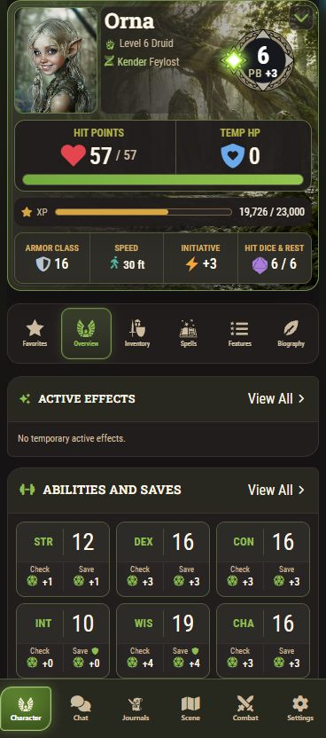
  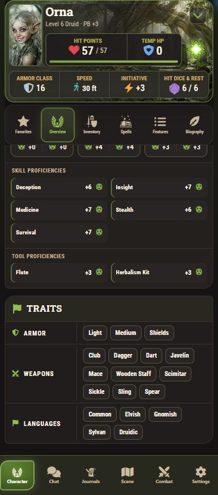
</p>

## Dungeons & Dragons Fifth Edition

D&D5e has dedicated **Character, NPC, Group, and Vehicle** layouts using the
system's calculated statistics and actions.

### Characters and NPCs

Navigate **Favorites, Overview, Inventory, Spells, Features, and Biography**.
Class accents and optional artwork personalize the header; tapping character
artwork opens a full-screen viewer.

- **Essentials:** HP/temp HP, Heroic Inspiration, death saves, abilities, saves,
  skills, conditions, active effects, hit dice, and native rests.
- **Items and spells:** expandable descriptions, native activities and use
  actions, spell slots, supported resources, favorites, and sorting.
- **Equipment:** currency, containers, and supported equipment controls.
- **NPCs:** their own identity, challenge information, statistics, and actions.

Native activity dialogs and follow-up controls remain available above VE Mobile.
Behavior depends on D&D5e and any automation modules involved.

<p align="center">
  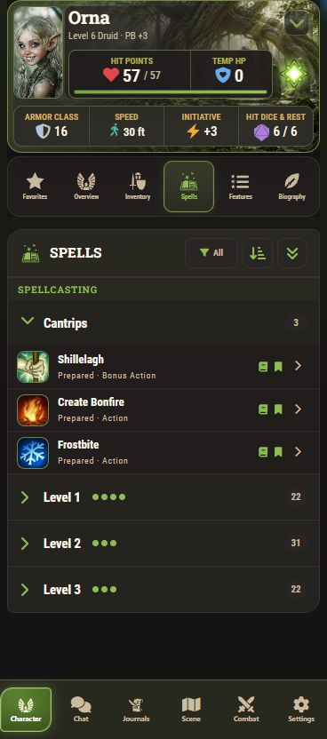
  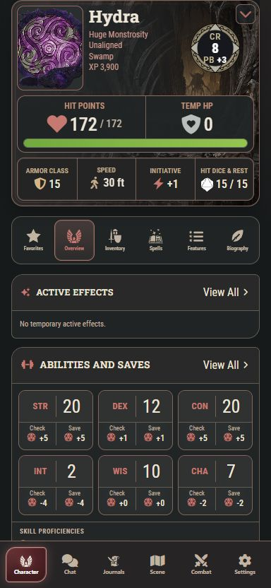
</p>

### Groups and vehicles

**Groups** organize **Members, Supplies, and About**. Review permitted member
summaries, open their sheets, and return to the group. Shared inventory and
travel information appear where available.

**Vehicles** organize **Status, Actions, Cargo, and Details**: defenses, movement,
components, stations, cargo, capacities, and permitted crew references.
Supported component and activity actions use native workflows.

**Native configuration & edit** opens the assigned sheet for broader operations;
VE Mobile does not provide an editor for every field. See the
[Group](docs/screenshots/group-sheet.png) and
[Vehicle](docs/screenshots/vehicle-sheet.png) examples.

## Pathfinder Second Edition

> **PF2e in 1.1.0 is a community test build — constructive feedback welcome.**
>
> I'm primarily a D&D player. I can test the controls in Foundry, but need
> experienced PF2e players to explain the expected results and help fine-tune
> the sheet and fix bugs.
>
> In [GitHub Issues](https://github.com/Silvestrae/ve-mobile/issues), include
> **what you did, what should happen, and what actually happened**, plus the
> relevant class, item/spell, and setup. Expected rolls, resource costs and
> condition changes—or a comparison with the standard PF2e sheet—are especially
> helpful.

PF2e supports **player characters on Foundry v14+**. Other actor types, including
NPCs, familiars and companions, are excluded from its actor chooser.

### PF2e phone screenshots

<p align="center">
  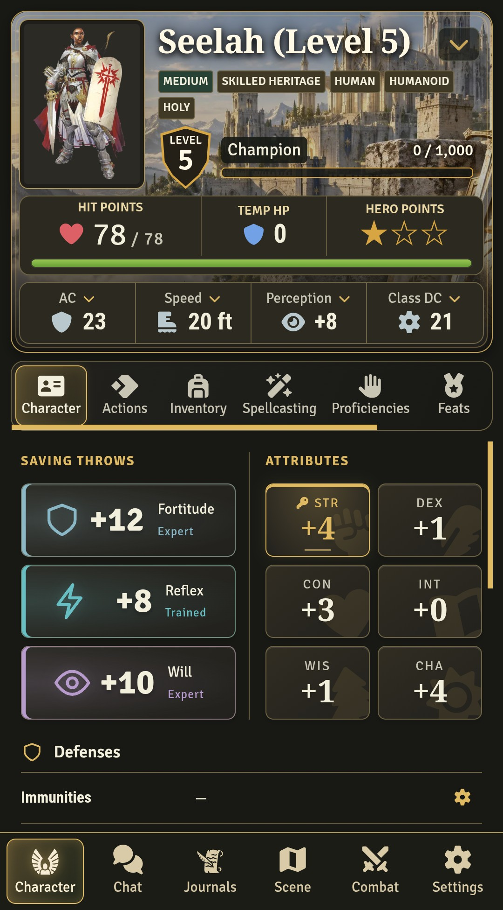
  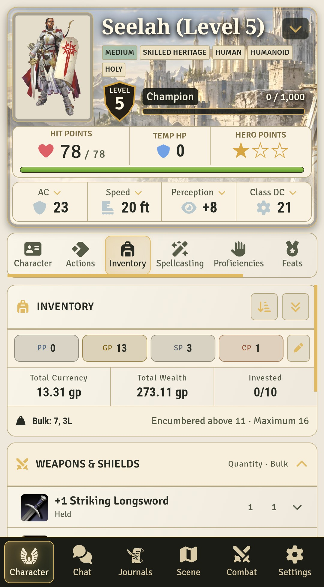
  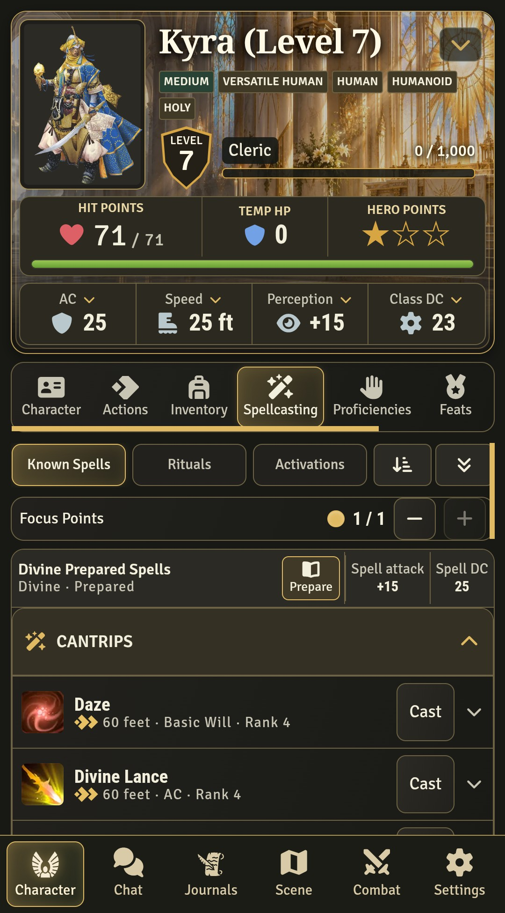
</p>

Seelah (Level 5) and Kyra (Level 7), shown in the running PF2e sheet at phone
viewport size. [View all ten light/dark screenshots](docs/screenshots/pf2e/README.md),
including Actions and spell preparation.

### Character sheet

The header brings together identity, traits, level/XP, HP/temp HP and Hero Points.
All 29 PF2e 8.6.1 classes have artwork and colours, adjustable in Appearance.
Expand **AC, Speed, Perception or Class DC** for more controls; initiative is
under Perception. Dying/Wounded indicators and Recovery appear when needed.
Tap the portrait to view it full-screen.

| Tab | What it contains |
| --- | --- |
| **Character** | Fortitude, Reflex, Will, attributes, defenses, background, deity, languages, senses, and Rest overnight. Background/deity cells open item details. |
| **Actions** | Encounter, Exploration, and Downtime views; Attacks with MAP variants, damage and critical damage; abilities, reactions, and supported resources. |
| **Inventory** | Currency/wealth, Bulk, investment, equipment, quantity, containers, carry state, and supported charges. |
| **Spellcasting** | Casting entries, spell attacks/DCs, spells by rank, Focus, preparation, rituals, and item activations. |
| **Proficiencies** | Core/lore skills, attack and defense proficiencies, and class DC entries. |
| **Feats** | Grouped class features and feats with expandable descriptions. |
| **Effects** | Conditions, effects, counters, durations, and available divine intercessions. |
| **Biography** | Appearance, backstory, personality, and campaign text with mobile editing. |

Category headers collapse and remember their state between tab changes. Sort
and expand/collapse-all controls appear where useful.

### Actions, conditions, and resources

Expand an Attack for available draw, grip, sheathe, drop, ammunition and
versatile damage controls. Action costs and multiple attack penalties (MAP)
are shown separately. Elemental Blasts are supported.

**Conditions → View All** lets you toggle conditions or adjust their values.
Persistent damage has a formula/type editor and recovery controls. The Shield
editor offers HP adjustment and Repair.

Hero Points, Focus, available class resources, ability uses and item charges
have controls where supported by the system. Active Mythic Points replace
Hero Points. Class-specific replenishment rules still apply.

Item-specific toggles appear in that item's details; other toggles appear in
**Options** at the bottom of Actions. **Post to chat** shares a card without
automatically spending an action. VE does not track a three-action turn budget.

### Spellcasting and preparation

Use **Prepare spells** to manage prepared slots, including multiple copies of
the same spell, or add spells from installed compendiums. Signature, flexible,
innate, spontaneous and Focus casting follow the system's rules where available.

Rituals, scrolls and wands use the system's casting and consumption controls.
Unavailable or expended options cannot be used.

### Current boundaries

Character creation, advancement/feat acquisition, crafting/formula management,
and Pathfinder Society administration are outside the mobile sheet's current
scope. Staff preparation/charges remain deferred pending a supported native or
module-specific path. Ritual casting does not automate the entire procedure.

Not every specialist class or module mechanic has a dedicated control; coverage
needs representative class-by-class testing. Mythic resource display also needs
further testing in an actual Mythic campaign.

## Controls and shortcuts

- **Rows and icons:** rows expand details. Where an icon is an action control,
  tapping it uses the indicated native action or posts the card. Explicit
  **Cast**, roll, and resource controls identify the action being taken.
- **Hold actions:** D&D5e rows offer contextual menus. In PF2e, hold an eligible
  item or skill icon/control for Quickbar/Hotbar assignment. Actions vary with
  the surface and your permissions.
- **Action bars:** **Character Quickbar** keeps shortcuts for the selected actor
  view; **Foundry Hotbar** uses existing per-user macros. Both offer ten slots
  per page across five pages, with editing and arrangement controls.
- **Back/Escape:** closes topmost surfaces first. Navigation returns to Character
  before Back can leave the game, with the exit warning retained at that point.
- **Placement:** finish previews with **Place** or **Cancel**. Opening one alone
  does not place it.

The in-app **Controls & Gestures** guide explains contextual holds, dragging,
targeting, and placement. A dismissible first-use invitation links to it.

## Scene and token movement

| Gesture | Action |
| --- | --- |
| Drag with one finger | Pan the map. |
| Pinch with two fingers | Zoom. |
| Double-tap the **Scene navigation tab** | Pause or unpause the game (GM permission required; D&D5e and PF2e). |
| Tap an owned token | Select it; tapping again keeps it selected. |
| Quickly double-tap a visible token | Toggle targeting. |
| Hold an owned token, then release | Open its controls. |
| Hold, then drag | Move the token after the hold activates. |
| Tap **×** beside the movement control's token name | Deselect. |

Start the **Joystick** from its centre knob and swipe beyond the minimum distance.
Its outer edge does not start movement. The **D-pad** offers one-step taps:
six directions on hex grids, eight on square/gridless scenes. Native walls,
pause state, visibility, movement rules, and ownership still apply.

<p align="center">
  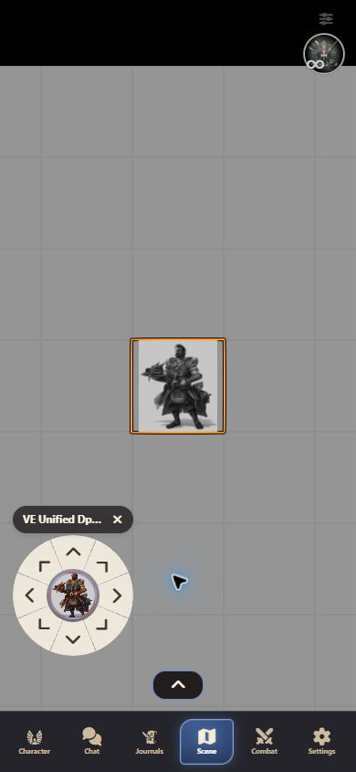
  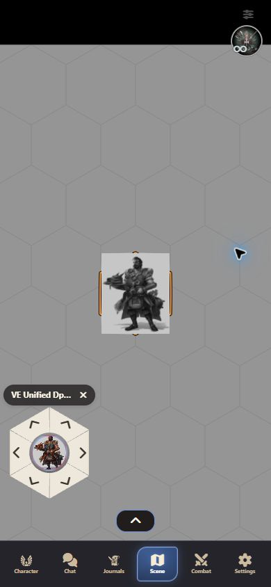
  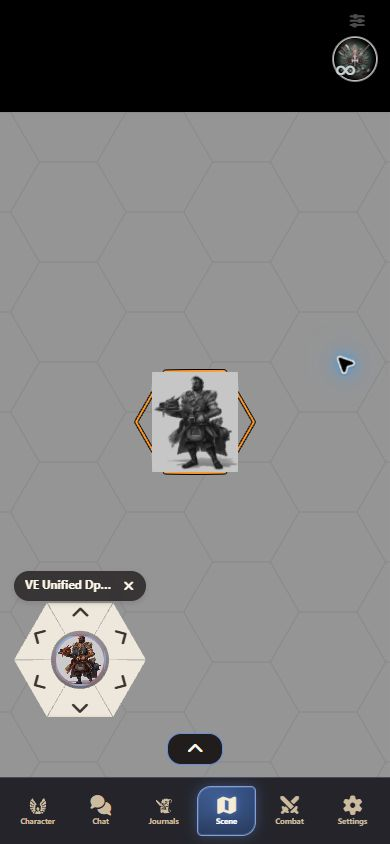
</p>

Eligible portraits and actor chooser rows offer token placement; Tablet Split
also supports portrait placement onto the Scene. Supported native area and
summon previews have touch controls. Foundry v14's Scene chooser offers level
selection for scenes that provide levels.

**Return to Scene after actions** defaults to **Off**. Choose **Always** or
**During combat only** to return Phone and Tablet Full after supported native
actions, keeping prompts and enabled summaries above the map. Tablet Split keeps
both panes visible. Resource edits and cancelled actions do not trigger a return.

## Chat, journals, and combat

**Chat** shows an unread-count badge while messages await reading. It clears when
you reach the newest message and remembers your read position per world and user
in this browser. It counts only messages you can see, including rolls.

Chat retains native messages, roll cards, interactive content, and the
composer. Supported Dice Tray controls and Polyglot language selection stay
with it. Optional action summaries collect available results without replacing
system cards or revealing hidden rolls.

**Journals** provide folders, pages, headings, and wrapped text. Pinch with two
fingers to adjust the reading font size, remembered in this browser. Images
open with zoom and pan. Authorized users can open the native journal editor,
although desktop editing screens may need more space.

**Combat** shows permitted turn order, targeting/focus controls, and native turn
controls appropriate to your role. GM controls sit on a solid panel: Roll All and
Roll NPCs before combat starts, then Previous and Next turns once it has started.
An optional Scene carousel keeps turn order
and **End Turn** above the map. Hidden information follows Foundry permissions.

## Appearance and performance

Choose light, dark or system appearance, class/custom colours, and header
artwork in **Settings → Appearance**.

For demanding maps, use the **Normal, Balanced, Strong or Maximum** graphics
profiles under **Performance & Memory**. Effects and 3D dice have separate controls.
GMs can use the **Mobile Asset Optimizer** to prepare smaller image copies
without replacing the originals.

**Disable game canvas** keeps sheets, chat, and journal reading available without
the live map. Map-dependent actions and some automation still require Canvas.
Accept any required reload after a change. **Keep Screen Awake** requires HTTPS
and a compatible browser; localhost is an exception.

<details>
<summary>Advanced recovery and module integrations</summary>

Scene memory warnings and optional automatic profile changes help with demanding
maps. Reconnect/resync and graphics recovery handle interrupted sessions.

Maintained integration paths include Midi-QOL for D&D5e activities/outcomes,
Dice So Nice roll hooks, Dice Tray, Polyglot, Monk's Active Tile Triggers, and
Force Client Settings. World settings policy and GM authority are respected.
These paths do not certify every version or combination. **Module Overlays
(Experimental)** exposes recognized controls, including supported Simple Calendar
and Monk's TokenBar patterns, on an opt-in, best-effort basis.

</details>

VE's interface supports **US English, Australian English, Spanish, German,
French, and Italian**. Foundry, systems, modules, and campaign content use their
own translations.

## Troubleshooting

| Problem | What to check |
| --- | --- |
| Updates or changes are missing | Fully reload Foundry and check the installed module version. |
| An actor/action is missing | Check ownership, the selected actor/token, and system support. PF2e lists character actors only. |
| Session looks stale | Let loading finish, use reconnect/resync, then **Reload Foundry** if recovery cannot complete. |
| Graphics fail or memory runs out | Try a lighter graphics profile or no-Canvas mode; follow graphics recovery prompts. |
| Item use fails without Canvas | Re-enable Canvas for automation that depends on it and accept the reload. |
| A native screen does not fit | Use the desktop-return control or a larger screen for that workflow. |
| Keep Screen Awake is unavailable | Use HTTPS and a browser supporting screen wake lock. |

Desktop-return leaves VE for the current page without changing saved Mobile
Mode. Choose **Desktop** in Mobile Mode to keep it off after reloading. **Open
Foundry Settings** provides access to core and other module settings.

## Feedback and support

Report reproducible problems through
[GitHub Issues](https://github.com/Silvestrae/ve-mobile/issues), using the bug
report template. Use the feature request template for suggestions. Include:

- VE Mobile, Foundry, and system versions.
- Browser, operating system, and device model.
- Layout: Phone, Tablet Split, Tablet Full, or Desktop; GM or Player.
- Reproduction steps, expected/actual behavior, and relevant enabled modules.
- A screenshot or short video, and any console error.

Remove passwords, authentication tokens, private campaign content, and personal
information before sharing a report.

If you would like to support development:

[](https://ko-fi.com/silvestrae)

## License and credits

VE Mobile is released under the [MIT License](LICENSE). Bundled third-party
fonts and adapted badge artwork retain their license notices in the stylesheet.

Battlemap shown in screenshots:
[Cropox Battlemaps — The Deepwood Hunting Lodge 45x40](https://www.patreon.com/CropoxBattlemaps/posts/deepwood-hunting-150490629).
The map is not bundled with VE Mobile and is not covered by its MIT license.

### Disclaimer

VE Mobile is developed and maintained with AI assistance, with design, testing,
and ongoing refinement guiding the project. It is independent and is not
affiliated with or endorsed by Foundry Gaming LLC, Wizards of the Coast, or Paizo.
