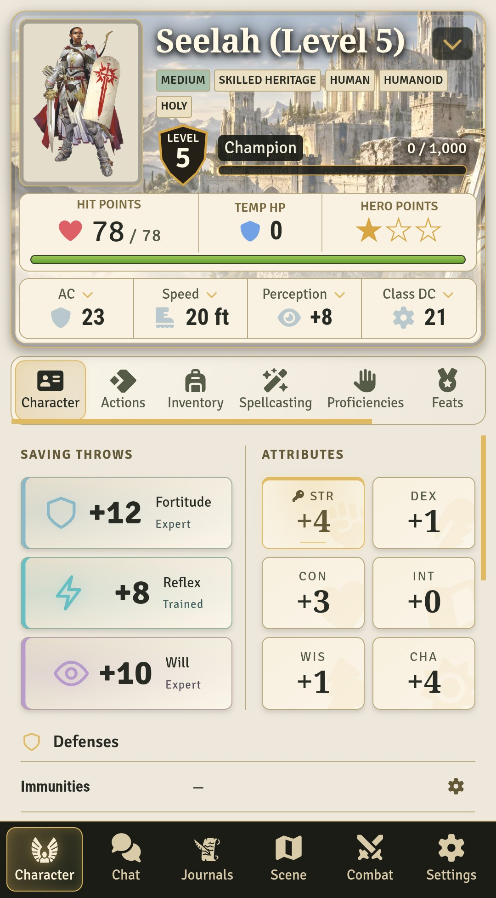
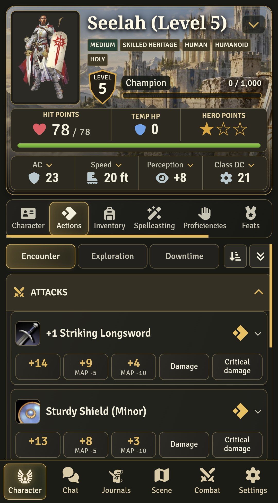
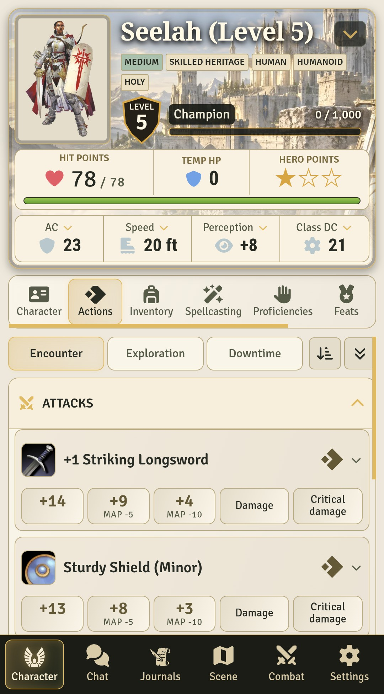
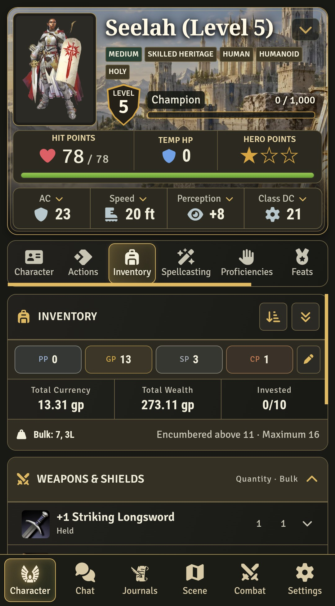
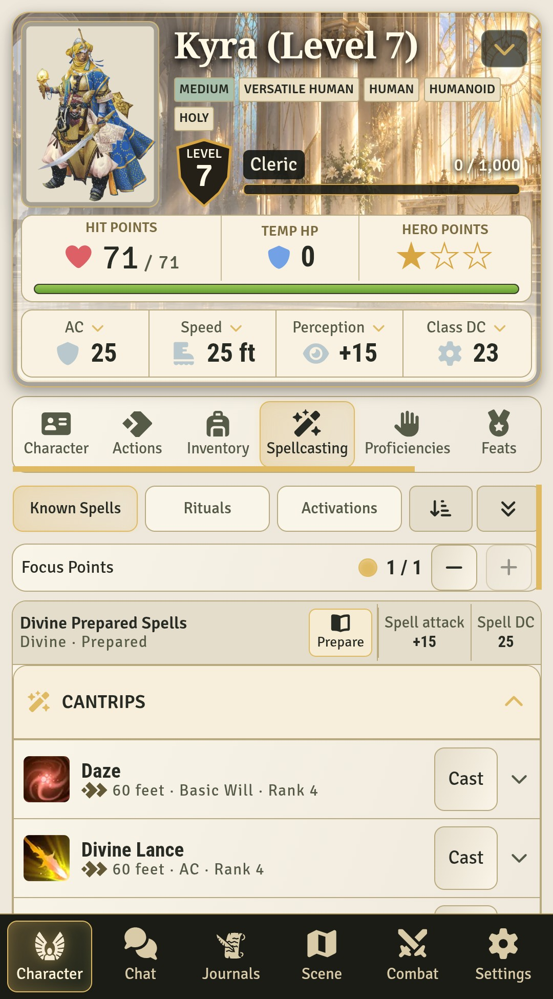
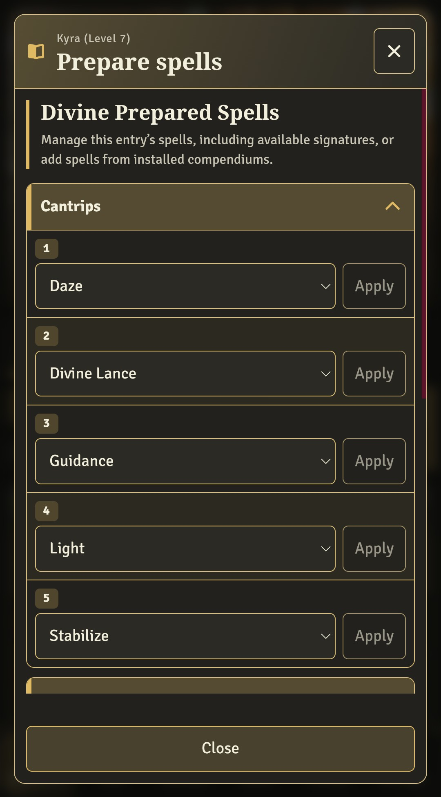
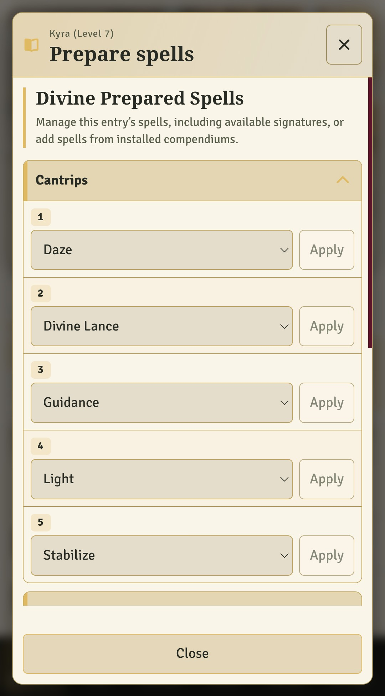

# PF2e phone layout

Captured on a Samsung Galaxy S25 Ultra in Chrome 156, running Foundry VTT
14.369 with PF2e 8.6.1 and VE Mobile 1.1.0. The phone viewport is 384 × 693 CSS
pixels; images contain only app content, excluding browser and system bars.

Seelah (Level 5) demonstrates the Character, Actions and Inventory tabs.
Kyra (Level 7) demonstrates Spellcasting and spell preparation.

| View | Dark mode | Light mode |
| --- | --- | --- |
| Character | [Open](character-dark.jpg) | [Open](character-light.jpg) |
| Actions | [Open](actions-dark.jpg) | [Open](actions-light.jpg) |
| Inventory | [Open](inventory-dark.jpg) | [Open](inventory-light.jpg) |
| Spellcasting | [Open](spellcasting-dark.jpg) | [Open](spellcasting-light.jpg) |
| Spell preparation | [Open](spell-preparation-dark.jpg) | [Open](spell-preparation-light.jpg) |

  
  

  
  

  
  

  
  

  
  

