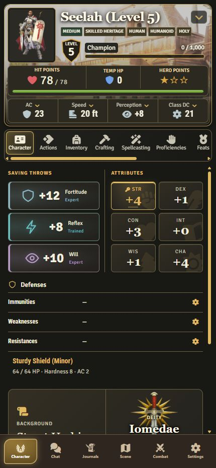
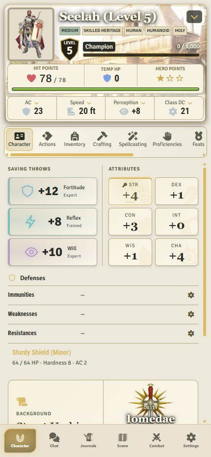
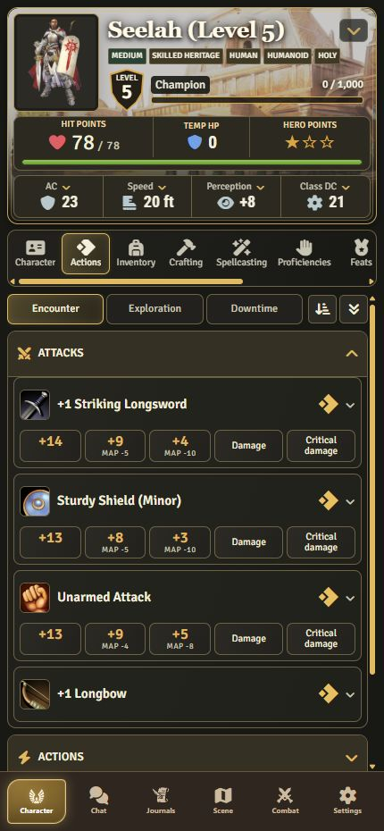
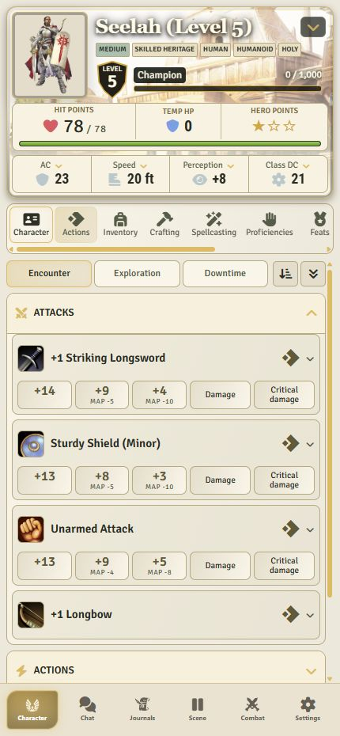
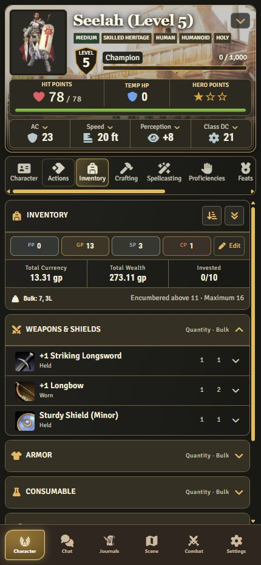
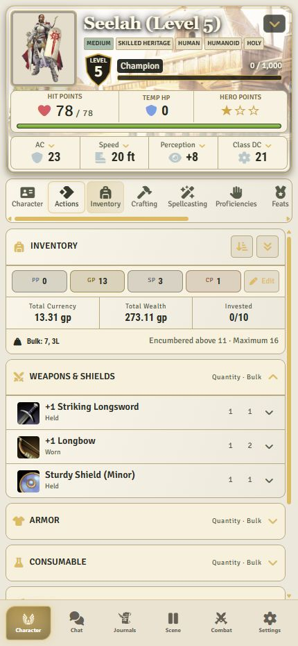
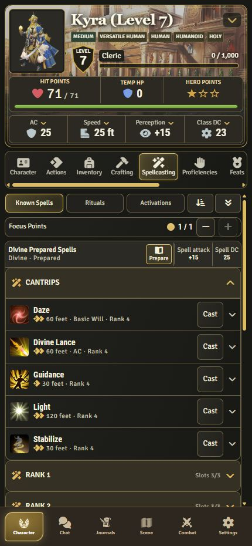
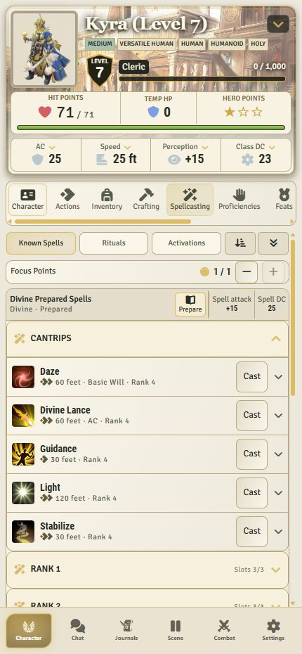
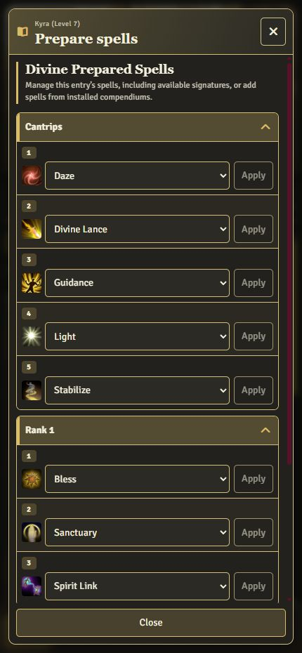
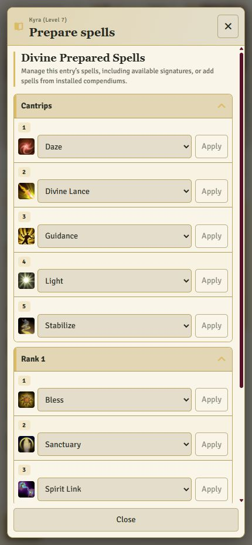

# PF2e phone layout

Captured in VE Mobile 1.2.0 on the local desktop Foundry VTT 14.369 world
running PF2e 8.6.1. The browser was set to a 430 × 930 CSS pixel viewport
with VE Mobile in Phone mode.

Seelah (Level 5) demonstrates the Character, Actions and Inventory tabs.
Kyra (Level 7) demonstrates Spellcasting and spell preparation.

Seelah and Kyra use the Paizo iconic portraits supplied with PF2e. Their
header uses *Merab, Golden Temple* by Mirco Paganessi.
[Header artwork credits](../../../assets/header-banners/credits.html)

| View | Dark mode | Light mode |
| --- | --- | --- |
| Character | [Open](character-dark.jpg) | [Open](character-light.jpg) |
| Actions | [Open](actions-dark.jpg) | [Open](actions-light.jpg) |
| Inventory | [Open](inventory-dark.jpg) | [Open](inventory-light.jpg) |
| Spellcasting | [Open](spellcasting-dark.jpg) | [Open](spellcasting-light.jpg) |
| Spell preparation | [Open](spell-preparation-dark.jpg) | [Open](spell-preparation-light.jpg) |

  
  

  
  

  
  

  
  

  
  

